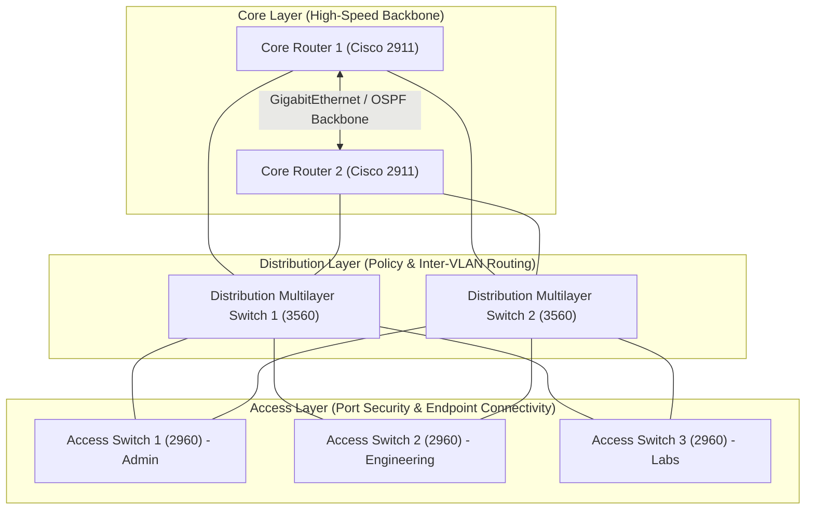

# 🌐 Enterprise Campus Network Architecture & Cisco Packet Tracer Simulation

[](https://www.netacad.com/)
[](#)
[](LICENSE)

A complete enterprise-grade multi-tier campus network infrastructure designed and simulated using **Cisco Packet Tracer**. Authored by **Ammar Abdelfattah** for the **Computer Networks & Data Communications** course at **Faculty of Engineering – New Ismailia National University (NINU)**.

---

## 📌 Network Topology & Hierarchical Design

The architecture strictly follows the **Cisco Three-Tier Hierarchical Model** (Core, Distribution, Access) ensuring high availability, fault tolerance, scalability, and deterministic routing:



---

## ⚙️ Implemented Protocols & Network Services

1. **VLAN Segmentation & 802.1Q Trunking**:
   - **VLAN 10**: Management & Administration (`192.168.10.0/24`).
   - **VLAN 20**: Faculty & Staff (`192.168.20.0/24`).
   - **VLAN 30**: Student & Research Labs (`192.168.30.0/24`).
   - **VLAN 99**: Native & Management Untagged VLAN (`192.168.99.0/24`).
2. **Switching & Redundancy**:
   - Spanning Tree Protocol (**Rapid-PVST+**) preventing broadcast storms and loops while ensuring sub-second failover.
   - Cisco EtherChannel (**LACP - 802.3ad**) link aggregation combining physical links into high-bandwidth logical trunks.
3. **Dynamic Routing**:
   - **OSPFv2 (Open Shortest Path First)** configured across Area 0 (Backbone) with link cost metrics optimized for Gigabit interfaces.
4. **Network Services & Security**:
   - **DHCP Pools**: Centralized IP reservation and default-gateway distribution with DHCP Snooping to block rogue servers.
   - **NAT / PAT**: Network Address Translation / Port Address Translation allowing internal RFC-1918 private subnets to communicate across the ISP link.
   - **Access Control Lists (ACLs)**: Extended IP ACLs isolating student lab traffic from financial and administrative management subnets.
   - **Switch Port Security**: Dynamic MAC address learning with violation modes configured to `restrict` / `shutdown`.

---

## 📁 Repository Structure

```text
├── topology/
│   └── enterprise_campus_network.pkt    # Master Cisco Packet Tracer topology file
├── configs/
│   ├── core_routers.ios                 # Cisco IOS startup-configs for Core layer
│   ├── distribution_switches.ios        # Multilayer routing and SVI configs
│   └── access_switches.ios              # Port security, VLAN, and trunking scripts
├── documentation/
│   └── ip_addressing_scheme.pdf         # VLSM sub-netting allocation matrix
└── README.md
```

---

## 👨‍💻 Author

- **Ammar Abdelfattah**
- Faculty of Engineering, **New Ismailia National University (NINU)**
